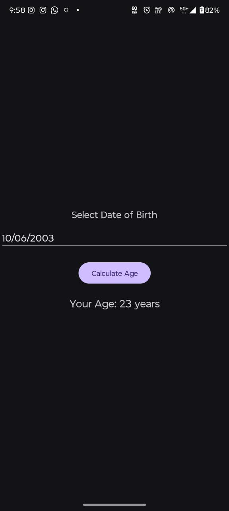

# Age Calculator
## Project Overview
A simple Android app developed using Kotlin and XML for the Veda Technology Android Development Track (Day 9). It calculates the user's age based on the selected date of birth.
## Technologies Used
- Kotlin
- XML Layouts
- Android Studio
## Features
- DatePicker to select Date of Birth
- Calculates age in years
- Handles empty input gracefully
## How to Run
1. Clone the repository. 2. Open in Android Studio. 3. Sync Gradle. 4. Run the app.
## Outcome
The application successfully calculates and displays the user's age based on the selected date of birth.
## Screenshot

